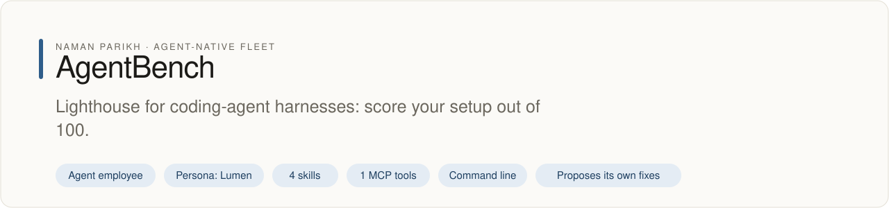

# agentbench

<!-- fleet:header:start -->
<p align="center"><picture><source media="(prefers-color-scheme: dark)" srcset="assets/banner-dark.svg"></picture></p>

<p align="center">
<a href="https://github.com/naman10parikh/agentbench/actions/workflows/ci.yml"></a>
<a href="https://github.com/naman10parikh/agentbench/releases"></a>
<a href="LICENSE"></a>
<a href="#use-it-from-any-coding-agent"></a>
<a href="https://x.com/naman10parikh"></a>
<a href="https://www.linkedin.com/in/naman-parikh1/"></a>
</p>

<p align="center"><a href="#quick-start">Quick start</a> · <a href="docs/README.md">How it works</a> · <a href="AGENTS.md">AGENTS.md</a> · <a href="llms.txt">llms.txt</a> · <a href="skills/">Skills</a> · <a href="https://github.com/naman10parikh/agentbench/discussions">Discussions</a> · <a href="https://github.com/naman10parikh">All projects</a></p>

**Lighthouse for coding-agent harnesses: score your setup out of 100.**

AgentBench is an agent employee, a packaged specialist agent with its own skills, memory and tests. It owns one job: evals. Its persona is Lumen. Coding agents use it through its skills, its MCP server and its command line. A scheduled job runs its evals and proposes fixes. A person makes every change.

_AgentBench is part of an agent-native play for agent-native systems that can eventually be recursively self-improving and evolving, operated by agent employees._

<p align="center"></p>
<!-- fleet:header:end -->

agentbench puts a number on a coding agent's harness: its `CLAUDE.md`, skills, rules and hooks. The static score
reads those files and scores them out of 100 with no API call. The benchmark holds the model fixed, sends 10 coding
tasks to the Anthropic API with your `CLAUDE.md` in the system prompt, and scores the replies. Run it before and after
a harness change to see whether the change helped.

<!-- fleet:use:start -->
## Use it from any coding agent

**Claude Code**: the plugin brings the skills, sub-agents, hooks and MCP server.

```
/plugin marketplace add naman10parikh/agentbench
/plugin install agentbench@agentbench
```

<details><summary>Its MCP server, Codex, Cursor, Gemini CLI, one skill and the command line</summary>

**Its MCP server**, in any MCP client:

```bash
claude mcp add --transport stdio agentbench -- npx -y -p github:naman10parikh/agentbench agentbench-mcp
codex mcp add agentbench -- npx -y -p github:naman10parikh/agentbench agentbench-mcp
```

Cursor (`.cursor/mcp.json`), Gemini CLI (`.gemini/settings.json`) and most other clients take the same command as JSON:

```json
{
  "mcpServers": {
    "agentbench": {
      "command": "npx",
      "args": [
        "-y",
        "-p",
        "github:naman10parikh/agentbench",
        "agentbench-mcp"
      ]
    }
  }
}
```

**Gemini CLI**: the extension brings the context and the MCP server.

```bash
gemini extensions install https://github.com/naman10parikh/agentbench
```

**One skill** (4 in all, in [skills/](skills/)), in any agent that reads Agent Skills:

```bash
gemini skills install https://github.com/naman10parikh/agentbench --path skills/benchmark-harness
git clone --depth 1 https://github.com/naman10parikh/agentbench /tmp/agentbench && cp -r /tmp/agentbench/skills/benchmark-harness ~/.claude/skills/
```

**The command line:**

```bash
npx -y -p github:naman10parikh/agentbench agentbench --help
```

</details>

Codex, Cursor, OpenCode, GitHub Copilot and other agents read [AGENTS.md](AGENTS.md); Claude Code reads [CLAUDE.md](CLAUDE.md) and Gemini CLI reads [GEMINI.md](GEMINI.md), which import it. [llms.txt](llms.txt) maps every surface for agents that read first.
<!-- fleet:use:end -->

## Quick start

You need Node 18 or newer. The static score needs nothing else.

```bash
# Run it straight from GitHub, nothing installed: score the harness in the folder you are in
npx -y -p github:naman10parikh/agentbench agentbench score

# Or keep a copy: clone, build, and put the commands on your PATH
git clone https://github.com/naman10parikh/agentbench && cd agentbench
npm install && npm install -g .
```

Score a project, then benchmark it:

```bash
agentbench score ~/my-project          # free: CLAUDE.md, skills, rules, hooks, out of 100
cd ~/my-project
export ANTHROPIC_API_KEY=...           # the benchmark calls the Anthropic API and costs money
agentbench --task 1                    # one task, the cheapest check
agentbench --json                      # all 10 tasks, as JSON
```

Every benchmark call writes its tokens and estimated cost to `.agentbench/runs.jsonl` in the folder you ran it in.

## How it works

### The static score (free)

`agentbench score [path]`, and the MCP tool `score-a-harness`, read the harness and give each part up to 25 points:

| Part | Points |
| --- | --- |
| `CLAUDE.md` | 0 if missing, 5 under 20 lines, 15 under 60 lines, 25 at 60 lines or more |
| Skills (`.claude/skills/**/*.md`) | 0 for none, 10 for 1 or 2, 18 for 3 to 7, 25 for 8 or more |
| Rules (`.claude/rules/**/*.md`) | 0 for none, 10 for 1 or 2, 18 for 3 to 7, 25 for 8 or more |
| Hooks and settings | 10 for a settings file, plus 3 per hook group in `.claude/settings.json` and `.claude/settings.local.json`, up to 25 |

It saves the result to `.agentbench/mcp-score-<date>.json` in the scored folder.

### The benchmark

```
1. Detect   →  reads CLAUDE.md, the settings files, .claude/skills/ and .claude/rules/
2. Run      →  one Messages API call per task, with the first 4,000 characters of CLAUDE.md and
               the task's file list in the system prompt, and five tool definitions
3. Judge    →  the 4 hard tasks also go to an LLM judge
4. Score    →  five dimensions, averaged to a score out of 100
5. Report   →  terminal scorecard, or JSON with --json (also saved under .agentbench/)
```

Each task gets a temporary folder with its starting files, and your own code is never touched. The tools in the call
are never run, so the benchmark reads only the model's first reply. Skills, rules and hooks are counted in the report
but not sent to the model.

| Dimension | How the code scores it |
| --- | --- |
| Completion | share of tasks done. A task is done when the reply calls a tool and the reply, with one `[tool: name(input)]` line per call, is longer than 50 characters. A hard task also needs a judge score of 50 or more. |
| Efficiency | baseline tokens divided by your tokens. No baseline is measured yet, so this is 50 on every run. |
| Tool use | 15 points per distinct tool called across all tasks, up to 100. |
| Recovery | of the replies that mention "error", "failed" or "exception", the share of tasks done; 50 when none do. |
| Quality | the average of the done rate and the share of replies with none of those words. |

The overall score is the average of the five. The "baseline" score in the report is a fixed 50; the baseline cache
(`.agentbench/cache/`, keyed by the task-suite version and the model) holds placeholder results until a measured
baseline exists.

### The 10 tasks

| # | Task | Difficulty |
| --- | --- | --- |
| 1 | Fix a typo in a TypeScript file | Easy |
| 2 | Add a function with a specific signature | Easy |
| 3 | Refactor a function to reduce complexity | Medium |
| 4 | Write unit tests for an existing module | Medium |
| 5 | Fix a failing test by reading error output | Medium |
| 6 | Add error handling to a function that throws | Medium |
| 7 | Resolve a merge conflict in a git repo | Hard |
| 8 | Find and fix a SQL injection vulnerability | Hard |
| 9 | Refactor 3 files to extract a shared utility | Hard |
| 10 | Add a REST endpoint with validation and tests | Hard |

The definitions are in `tasks/index.ts` and the starting files in `src/workspace.ts`. To add a task, follow
[skills/add-benchmark-task](skills/add-benchmark-task/SKILL.md).

### Options

| Flag or variable | Default | What it does |
| --- | --- | --- |
| `--task <n>` | all | Run one task (1 to 10) |
| `--json` | off | Print the report as JSON |
| `--compare <path>` | none | Benchmark another `CLAUDE.md` instead of the one in this folder |
| `--no-cache` | off | Ignore the cached baseline |
| `--model <id>` or `AGENTBENCH_MODEL` | built-in default | The model under test; it is a setting, never part of the score |
| `--judge-model <id>` or `AGENTBENCH_JUDGE_MODEL` | built-in default | The LLM judge's model for the hard tasks |
| `--verbose` | off | Print each task's result as it runs |

The flag wins over the environment variable. The built-in defaults are in `src/index.ts` and `src/evaluator.ts`.

### More commands

| Command | What it does |
| --- | --- |
| `agentbench sandbox-run --task <n>` | boot an E2B microVM with a task's starting files and list them there (needs `E2B_API_KEY`) |
| `agentbench memory-search "<query>"` | BM25 search over the memory and docs of the folder you run it in |

### Improving your score

| Low score in | What to try |
| --- | --- |
| Completion | Clear completion criteria in `CLAUDE.md` |
| Efficiency | Model routing rules (a small model for simple subtasks) |
| Tool use | Tool preference rules ("use Read instead of cat") |
| Recovery | An error escalation protocol or a troubleshooting skill |
| Quality | Code style rules and a pre-commit quality gate hook |

### Other benchmarks

| Benchmark | What it tests | How agentbench differs |
| --- | --- | --- |
| SWE-bench | Model ability on GitHub issues | It tests the harness, not the model |
| HumanEval | Code generation | Single function, no tool use |
| MBPP | Python programming | No harness awareness |
| Aider benchmark | Edit accuracy | Does not score efficiency or recovery |

agentbench holds the model constant and measures the harness.

### Tests and evals

```bash
pnpm install && pnpm build
pnpm test         # vitest: the scorer's unit tests
pnpm eval         # every surface, then the whole CLI against a stand-in API, pass^3
```

The evals never call a paid API: `eval/stub-api.mjs` stands in for the Messages API. CI runs both on every push and
pull request. New tasks and sharper scoring rules are the most useful contributions.

<!-- fleet:anatomy:start -->
## What it is made of

Every project in this fleet is graded on the same 11 harness components and on self-improvement. Each mark is backed by a file you can open.

| Component | Grade | Where |
| --- | --- | --- |
| Identity | ✅ | identity/SOUL.md:1 (Lumen; BRAND, HEARTBEAT and bootstrap MEMORY rewritten, no template slots) |
| Memory | ✅ | memory/MEMORY.md:1 (about 680 tokens) + BM25 index src/memory-index.ts:208 (agentbench memory-search) + memory/LEARNINGS.md (6 rules) |
| Skills | ✅ | skills/benchmark-harness/SKILL.md:1, skills/add-benchmark-task/SKILL.md:1, skills/sandbox-run/SKILL.md:1, skills/memory-search/SKILL.md:1 |
| Tools/CLIs | ✅ | package.json:7 (bins agentbench, agentbench-mcp); src/index.ts:17 (--version); new free command agentbench score |
| Hooks | ✅ | .claude/settings.json:4 (SessionStart context, PreToolUse dangerous-command and secret guards) + hooks/hooks.json:3 (plugin harness-change hook) |
| Sub-agents | ✅ | .claude/agents/bench-runner.md:1, .claude/agents/task-author.md:1 (bundled in .claude-plugin/plugin.json) |
| MCPs | ✅ | src/mcp-server.ts:54 (own stdio server, score-a-harness; bin agentbench-mcp) + .mcp.json:3 |
| Dispatch | ✅ | src/runner.ts:23 (runBenchmark) and src/runner.ts:53 (one call per task, judge for hard tasks); scheduled run .github/workflows/improve.yml:9 |
| Evals | ✅ | eval/run.sh:1 (surfaces 44, golden 9 tasks pass^3 against a stand-in API) gating CI .github/workflows/ci.yml:35 |
| Observability | ✅ | src/observability.ts:71 (append-only .agentbench/runs.jsonl, tokens and estimated cost per call) + src/observability.ts:77 |
| Sandbox/Infra | ✅ | src/sandbox.ts:58 (E2B microVM with the task's starting files; the check lists them, tsc only when the template has it) |
| Self-improvement | ✅ | dsip.json:1 (L2) + .github/workflows/improve.yml (nightly loop) + scripts/improve.mjs |

✅ real and tested · 🟡 partial, with the reason in the row · ❌ absent
<!-- fleet:anatomy:end -->

<!-- fleet:footer:start -->
## How it improves itself

It carries its own evals and a self-improvement contract, [`dsip.json`](dsip.json), which says what it may change and how a change is judged. A scheduled job runs its evals and proposes fixes. A person makes every change. Lessons it learns are kept as rules in its memory files.

## Part of a fleet

One of the projects by [Naman Parikh](https://github.com/naman10parikh). Each owns one part of an agent's harness, or of the product around an agent, and all of them follow one standard.

| Related project | What it owns |
| --- | --- |
| [AgentDial](https://github.com/naman10parikh/agentdial) | Identity |
| [WikiMem](https://github.com/naman10parikh/wikimem) | Memory |
| [Skillsmith](https://github.com/naman10parikh/skillsmith) | Skills |
| [Agent Booster](https://github.com/naman10parikh/agent-booster) | Tools / CLIs |
| [Armory](https://github.com/naman10parikh/armory) | MCPs and the component registry |
| [AgentGrid](https://github.com/naman10parikh/agentgrid) | Dispatch |
| [AgentSwarm](https://github.com/naman10parikh/agentswarm) | Dispatch |
| [AgentMoney](https://github.com/naman10parikh/agentmoney) | Observability |
| [Claude Harness](https://github.com/naman10parikh/claude-harness) | The whole harness, as a template |

## Community

Questions and ideas go to [Discussions](https://github.com/naman10parikh/agentbench/discussions); bugs go to [issues](https://github.com/naman10parikh/agentbench/issues/new/choose). Follow the work on [X](https://x.com/naman10parikh) and [LinkedIn](https://www.linkedin.com/in/naman-parikh1/).

## Contributing and security

Read [CONTRIBUTING.md](CONTRIBUTING.md). AI-assisted pull requests are welcome. Report a vulnerability privately, as [SECURITY.md](SECURITY.md) explains.

## Star history

If it is useful to you, a star helps other people find it.

<a href="https://star-history.com/#naman10parikh/agentbench&Date"><picture><source media="(prefers-color-scheme: dark)" srcset="https://api.star-history.com/svg?repos=naman10parikh/agentbench&type=Date&theme=dark"></picture></a>

## Contributors

<a href="https://github.com/naman10parikh/agentbench/graphs/contributors"></a>
<!-- fleet:footer:end -->

## License

MIT, see [LICENSE](LICENSE).
