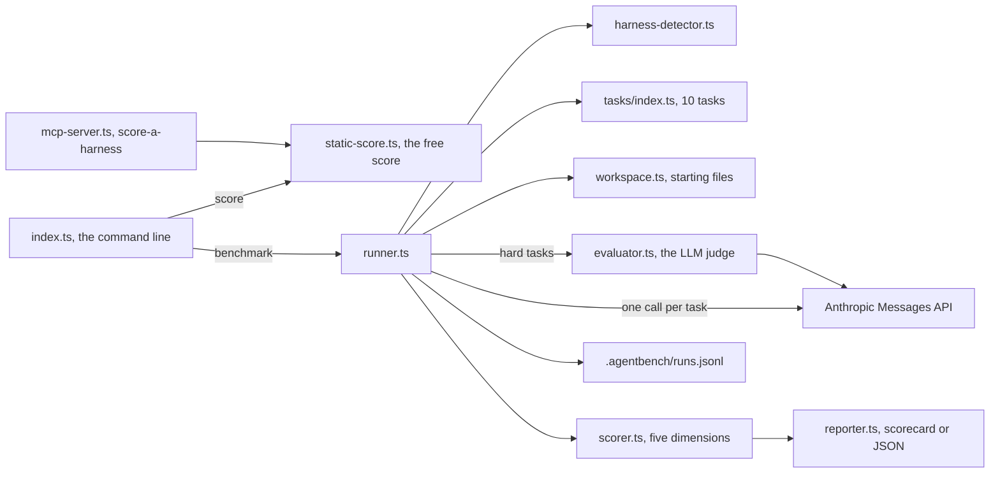

# How AgentBench works

AgentBench puts a number on a coding agent's harness. A harness is the setup around the model: `CLAUDE.md`, skills, rules and hooks. The static score reads those files and scores them out of 100, with no API call. The benchmark holds the model fixed, sends 10 coding tasks to the Anthropic API with your `CLAUDE.md` in the system prompt, and scores the replies. It is for people who change their harness and want to know whether the change helped.

## The parts

[src/index.ts](../src/index.ts) is the command line. `agentbench score [path]` runs [src/static-score.ts](../src/static-score.ts). It gives up to 25 points each to `CLAUDE.md`, skills, rules, and hooks with settings, and saves the result under `.agentbench/`. The MCP server in [src/mcp-server.ts](../src/mcp-server.ts) offers the same score as one tool, `score-a-harness`. MCP (Model Context Protocol) is the standard way coding agents call outside tools.

The benchmark starts in [src/runner.ts](../src/runner.ts). [src/harness-detector.ts](../src/harness-detector.ts) counts what your harness holds. [tasks/index.ts](../tasks/index.ts) defines the 10 tasks, and [src/workspace.ts](../src/workspace.ts) holds each task's starting files. The four hard tasks also go to an LLM judge in [src/evaluator.ts](../src/evaluator.ts): a second model call that grades the reply from 0 to 100. [src/scorer.ts](../src/scorer.ts) turns the results into five scores. [src/reporter.ts](../src/reporter.ts) prints them. [src/observability.ts](../src/observability.ts) logs the tokens and estimated cost of every call. Two side commands complete the set: `sandbox-run` in [src/sandbox.ts](../src/sandbox.ts) and `memory-search` in [src/memory-index.ts](../src/memory-index.ts).

## What happens when you run it

1. `agentbench` with no subcommand runs the `benchmark` command in [src/index.ts](../src/index.ts). It stops at once if `ANTHROPIC_API_KEY` is not set.
2. [src/runner.ts](../src/runner.ts) calls `detectHarness` from [src/harness-detector.ts](../src/harness-detector.ts). It counts the `CLAUDE.md` lines, skills, rules and hook groups in the current folder.
3. It loads the tasks from [tasks/index.ts](../tasks/index.ts), or one task with `--task`. [src/cache.ts](../src/cache.ts) loads a baseline from `.agentbench/cache/`, or saves placeholder results there.
4. For each task, [src/workspace.ts](../src/workspace.ts) writes the starting files to a new temporary folder. Your own code is never touched.
5. The runner sends one Messages API request per task. The system prompt holds the first 4,000 characters of your `CLAUDE.md` and the list of starting files. The request defines five tools, but they are never run. Only the model's first reply is read.
6. A task counts as done when the reply calls a tool and is longer than 50 characters. A hard task goes to the judge in [src/evaluator.ts](../src/evaluator.ts) and counts as done at a grade of 50 or more.
7. [src/observability.ts](../src/observability.ts) appends the task's tokens and estimated cost to `.agentbench/runs.jsonl`. The temporary folder is then deleted.
8. [src/scorer.ts](../src/scorer.ts) scores completion, efficiency, tool use, recovery and quality, each out of 100. Efficiency has no baseline run to compare with yet, so it shows as not measured, with no score. The overall score is the average of the other four.
9. [src/reporter.ts](../src/reporter.ts) prints a scorecard, or JSON with `--json`. It saves the full report as `.agentbench/report-<date>.json`.

## Extending it

- **A task.** Follow [skills/add-benchmark-task/SKILL.md](../skills/add-benchmark-task/SKILL.md). Add the definition to `loadTasks()` in [tasks/index.ts](../tasks/index.ts). Add its starting files under the same id in `TASK_FIXTURES` in [src/workspace.ts](../src/workspace.ts). The numbered folders under [tasks/](../tasks/) are older reference material, and the code does not read them.
- **A scoring rule.** Change [src/scorer.ts](../src/scorer.ts) and its unit tests in [src/scorer.test.ts](../src/scorer.test.ts).
- **A command.** Add a `program.command(...)` block in [src/index.ts](../src/index.ts). Document it in [AGENTS.md](../AGENTS.md), [README.md](../README.md) and [llms.txt](../llms.txt). The nightly loop in [scripts/improve.mjs](../scripts/improve.mjs) flags any command those files never mention.
- **An MCP tool.** Add it to `TOOLS` and to the `tools/call` branch in [src/mcp-server.ts](../src/mcp-server.ts).
- **A skill.** Add `skills/<name>/SKILL.md` with `name` and `description` front matter. [eval/surfaces.py](../eval/surfaces.py) checks its shape. The current skills are in [skills/](../skills/).
- **An eval.** Add a golden task to [eval/golden.sh](../eval/golden.sh) with its `ok` and `bad` helpers. [eval/stub-api.mjs](../eval/stub-api.mjs) stands in for the Messages API. The API key you pass picks how it answers.

Then run `pnpm build && pnpm test && pnpm eval`. CI runs the same steps on every push and pull request, in [.github/workflows/ci.yml](../.github/workflows/ci.yml).

## Questions

**Does it need an API key or cost money?** The static score and memory search are free and need no key. The benchmark needs `ANTHROPIC_API_KEY` and costs money. It makes one call per task, plus one judge call per hard task. `sandbox-run` needs `E2B_API_KEY`.

**Does any data leave the machine?** The static score sends nothing. The benchmark sends the task prompt, the first 4,000 characters of your `CLAUDE.md` and the starting file names to the Anthropic API. The judge sends the task description and the model's reply. `sandbox-run` uploads a task's starting files, not your code, to an E2B sandbox.

**How does it improve itself?** Its self-improvement contract, [dsip.json](../dsip.json), declares DSIP level L2. Darwin's DSIP checker verifies L2 from the repository itself. The evals gate every push and pull request. A nightly workflow, [.github/workflows/improve.yml](../.github/workflows/improve.yml), runs [scripts/improve.mjs](../scripts/improve.mjs). That script runs the evals, compares the live commands and MCP tool with the docs and skills, and writes `.agentbench/proposal.md`. The workflow then opens one issue labelled `proposal`, or updates the one already open, so a person can review it. The loop never merges, and it never calls a paid API. A person makes every change.

**How do I run its tests and evals?** Run `pnpm install && pnpm build`, then `pnpm test` for the scorer's Vitest unit tests. `pnpm eval` runs [eval/run.sh](../eval/run.sh): a check of every install surface, then the whole command line against the stand-in API. Each golden task must pass three rounds in a row. No paid call is made.

**What does it not do?** It never runs the model's tool calls or its code. It reads only the first reply. Skills, rules and hooks are counted in the report but not sent to the model. No baseline run is measured yet, so the report shows efficiency and the baseline as not measured. Tool use counts distinct tools, not whether they were the expected ones.
